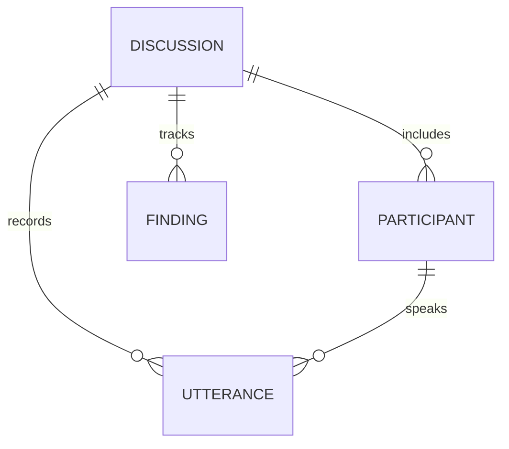

# AI Panel Studio 数据模型

本版选用 SQLite 保存场次及公开讨论内容。

| 实体 | 主要数据 |
| --- | --- |
| 场次 | 标识、话题、专家人数、状态和总结。 |
| 参与者 | 所属场次、主持人或专家角色、姓名、头衔、立场、颜色及公开状态。 |
| 发言 | 所属场次、发言者、顺序及正文。 |
| 讨论观点 | 所属场次、共识或分歧类型、观点内容。 |

每条发言关联本场参与者。场次详情和实时更新均按场次隔离。
